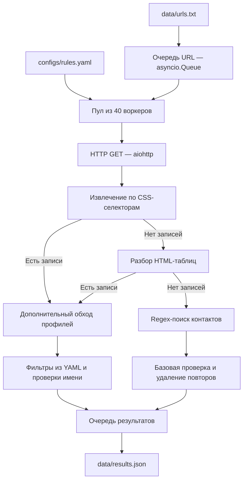

# Crawler Python

Асинхронный консольный краулер для сбора контактных данных с HTML-страниц. Приложение принимает список URL, извлекает имена, email и телефоны и сохраняет результаты в JSON. Правила поиска задаются в YAML, поэтому CSS-селекторы можно адаптировать под конкретный сайт без изменения парсера.

Проект разработан как экспериментальный инструмент для обработки страниц сотрудников и контактных разделов, в том числе сайтов университетов. Он демонстрирует работу с асинхронным HTTP, очередями задач, конфигурацией, неоднородной HTML-разметкой и наблюдаемостью приложения.

## Возможности

- Конкурентная загрузка страниц: 40 асинхронных воркеров на `asyncio` и `aiohttp`.
- Извлечение полей по CSS-селекторам, включая ссылки `mailto:` и `tel:`, атрибуты `data-*`, `aria-label` и `title`.
- Резервный разбор HTML-таблиц по заголовкам столбцов с именами, email и телефонами.
- Поиск контактов регулярными выражениями, если карточки и таблицы не дали результатов.
- Ограниченный переход на персональные страницы для получения дополнительных данных.
- Фильтрация записей по обязательным полям, подстрокам, длине имени и стоп-словам.
- Экспорт в JSON, отдельные логи приложения и воркеров, отчёт о времени выполнения и памяти.

## Технологии

| Технология | Назначение |
| --- | --- |
| Python, `asyncio` | Цикл событий, очереди и управление конкурентными задачами |
| `aiohttp` | Асинхронные HTTP-запросы и клиентские сессии |
| Beautiful Soup, `lxml`, SoupSieve | Разбор HTML и поиск по CSS-селекторам |
| PyYAML, `dataclasses` | Загрузка YAML в структуры конфигурации |
| `re` | Резервное извлечение email и телефонов |
| `logging`, `psutil` | Диагностика и измерение потребления ресурсов |

Асинхронность позволяет обрабатывать другие URL во время ожидания сетевых ответов. HTML-парсинг выполняется синхронно в том же процессе; отдельные потоки или процессы для него не создаются.

## Как устроена обработка



Каждый воркер создаёт свою HTTP-сессию и последовательно забирает URL из общей очереди. Сетевой запрос ограничен таймаутом в 15 секунд; ответ с HTTP-статусом, отличным от `200`, считается ошибкой. Ошибки загрузки фиксируются в результате обработки, после чего воркер переходит к следующему URL.

Для карточек и таблиц применяется фильтрация структурированных записей. Если они ничего не нашли, regex-поиск работает по HTML всей страницы и использует отдельный набор базовых фильтров. Если записи были найдены, но затем отсеяны фильтрами, повторный regex-поиск не запускается.

Обход профилей включается при наличии `profile_link` и от 1 до 20 извлечённых записей на исходной странице. Воркеры посещают не более пяти найденных ссылок, последовательно, без дальнейшего рекурсивного обхода.

## Структура проекта

```text
Crawler_Python/
├── main.py                    # Запуск, очереди, сбор результатов и экспорт
├── requirements.txt           # Зависимости
├── configs/
│   └── rules.yaml             # Правила извлечения и фильтрации
├── data/
│   ├── urls.txt               # Входной список URL
│   └── results.json           # Результаты последнего запуска
├── internal/
│   ├── config/dsl.py          # Dataclass-модели и загрузчик YAML
│   ├── engine/worker.py       # HTTP-загрузка и асинхронные воркеры
│   ├── parser/html.py         # CSS, таблицы, regex и фильтры
│   └── metrics/monitor.py     # Время выполнения и метрики ресурсов
├── crawler.log               # Общие события и итоговая статистика
└── worker.log                # Подробности обработки страниц
```

## Быстрый старт

Нужны Python и `pip`. Импорт зависимостей и локальная проверка парсера выполнены на Python 3.14; версии библиотек заданы в `requirements.txt` нижними границами.

### 1. Установить зависимости

Выполните из корня скачанного или клонированного проекта:

```bash
python -m venv .venv
```

Активация в Windows PowerShell:

```powershell
.\.venv\Scripts\Activate.ps1
```

Активация в Linux / macOS:

```bash
source .venv/bin/activate
```

Установка:

```bash
python -m pip install -r requirements.txt
```

### 2. Подготовить URL

Укажите адреса страниц в `data/urls.txt`, по одному на строку. Пустые строки и строки, начинающиеся с `#`, игнорируются.

**В текущем файле находятся 1000 адресов вида `http://127.0.0.1:5000/page/1?delay=50`. Это входные данные для локального эксперимента. Код тестового сервера в проект не входит: перед обычным запуском замените список адресами нужного сайта.**

URL берутся именно из `data/urls.txt`. Поле `crawler_task.start_urls` из YAML сейчас не используется при запуске.

### 3. Настроить извлечение

Отредактируйте `configs/rules.yaml` под разметку выбранных страниц. Например, для карточек сотрудников:

```yaml
crawler_task:
  name: "staff_contacts"
  extract_rules:
    - name: "staff_member"
      selector: ".person"
      fields:
        full_name: ".name"
        email: "a[href^='mailto:']"
        phone: "a[href^='tel:']"
      profile_link: "a[href*='/personal/']"
  filters:
    exclude_empty: ["full_name"]
    must_contain: []
```

Этот пример соответствует HTML:

```html
<div class="person">
  <span class="name">Иванов Иван Иванович</span>
  <a href="mailto:ivanov@example.org">Написать</a>
  <a href="tel:+79990000000">Позвонить</a>
</div>
```

| Параметр | Поведение |
| --- | --- |
| `name` | Название задачи в сообщениях запуска |
| `extract_rules[0].selector` | CSS-селектор контейнеров с данными |
| `extract_rules[0].fields` | Соответствие имён выходных полей CSS-селекторам внутри контейнера |
| `extract_rules[0].profile_link` | Селектор ссылок на профили внутри контейнера; пустая строка отключает переходы |
| `filters.exclude_empty` | Поля, которые должны содержать непустое значение |
| `filters.must_contain` | Каждая указанная подстрока должна встретиться хотя бы в одном значении записи; поиск учитывает регистр |

Можно перечислить альтернативные селекторы через запятую. Для поля выбирается первое найденное непустое значение в порядке перечисления. При пересечении селекторов контейнеров возможны повторные записи.

Структурированные записи дополнительно проходят встроенные проверки: длина `full_name` от 5 до 50 символов, отсутствие стоп-слов в имени и наличие `@` в непустом email. Эти проверки действуют независимо от `exclude_empty`. Для regex-результатов имя не требуется, а YAML-фильтры не применяются.

### 4. Запустить

```bash
python main.py
```

Запускайте команду из корня проекта: пути к конфигурации, входному файлу и результатам заданы относительно рабочей директории.

После обработки приложение запишет данные в `data/results.json` и выведет количество успешно загруженных исходных страниц, ошибок и сохранённых записей, а также отчёт о ресурсах. Успешная загрузка страницы не означает, что на ней найдены контакты.

`data/results.json`, `crawler.log` и `worker.log` перезаписываются при новом запуске с непустым списком URL; логи открываются на перезапись уже при старте приложения.

## Формат результата

Пример с вымышленными данными:

```json
[
  {
    "full_name": "Иванов Иван Иванович",
    "email": "ivanov@example.org",
    "phone": "+79990000000"
  },
  {
    "email": "info@example.org"
  }
]
```

Отсутствующие поля не добавляются в объект. Regex-поиск может вернуть только email или телефон. Он сопоставляет найденные телефоны с email по порядку, поэтому такая запись не гарантирует принадлежность контактов одному человеку. URL источника в итоговый JSON сейчас не включается.

## Диагностика и результаты эксперимента

- `crawler.log` содержит события запуска, ошибки загрузки и итоговую статистику.
- `worker.log` показывает стадии извлечения, переходы на профили и число записей до и после фильтрации.
- Консольный отчёт содержит длительность запуска, RSS-память процесса и изменение RSS между началом и завершением. Это не измерение пикового потребления памяти. Показатель CPU берётся из системного `psutil.cpu_percent(interval=None)` и не является средней загрузкой процесса за весь запуск.

В сохранённом `crawler.log` зафиксирован эксперимент с **1000 успешно обработанными исходными URL, 0 ошибками загрузки и 20 000 сохранёнными записями** на локальном сервере. Это исторический результат из лога: тестовый сервер и воспроизводимый стенд в репозитории отсутствуют, поэтому эти числа не используются как гарантия производительности или точности на реальных сайтах.

## Текущие ограничения

- Из списка `extract_rules` используется только первое правило. `navigation.follow_links` и `navigation.max_depth` загружаются, но пагинация и управление глубиной через эти параметры пока не реализованы.
- JavaScript не исполняется: приложение обрабатывает HTML, полученный по HTTP.
- Нет повторных попыток, ограничения частоты запросов и обработки `robots.txt`.
- Глобальной дедупликации результатов и посещённых URL нет; удаление повторов применяется локально в regex-ветке.
- Результаты накапливаются в памяти и сохраняются после завершения всех воркеров.
- Фильтрация и regex-поиск используют эвристики: возможны пропуски и ложные совпадения.
- В проекте пока нет автоматизированного набора тестов и CI.

## Направления развития

- Добавить тесты парсера на HTML-фикстурах: карточки, таблицы, пустые страницы и неоднозначные контакты.
- Реализовать пагинацию, учёт посещённых адресов и ограничение обхода доменом.
- Добавить повторные попытки с задержкой и ограничение частоты запросов.
- Сохранять URL источника и способ извлечения для проверки качества данных.
- Вынести число воркеров, таймаут и пути к файлам в параметры запуска.
- Подготовить воспроизводимый локальный стенд для измерения производительности.

Эти пункты описывают дальнейшее развитие проекта и не входят в текущую реализацию.
